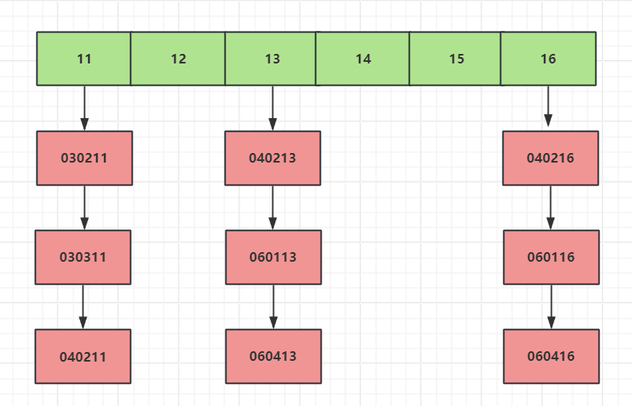

#   线程安全的查找表（哈希表实现）

## 简介
前文介绍了线程安全的队列和栈，本文继续介绍线程安全的查找结构，实现一个类似线程安全的 `map` 结构[cite: 28]。

通常 `std::map` 基于红黑树实现，如果要在增删节点时维持平衡，设计思路是依次锁定要删除或增加节点的父节点，然后修改子节点数据[cite: 28]。这种思路虽然可行，但复杂度高，且红黑树节点插入可能触发多次旋转、修改多个节点的关系[cite: 28]。此外，加锁流程是锁父节点再锁子节点，即使在处理子节点时释放父节点锁，锁粒度依然不够精细[cite: 28]。

因此，更适合并发读写的高性能查找结构是采用**散列表（Hash Table）**[cite: 28]。

---

## 散列表原理

散列表（Hash Table，也叫哈希表）是根据键（Key）直接访问在存储器存储位置的数据结构[cite: 28]。它通过计算一个键值的函数，将所需查询的数据映射到表中一个位置来访问，加速查找速度[cite: 28]。这个映射函数称作**散列函数（哈希函数）**，存放记录的数组称作**散列表**[cite: 28]。

### 举个例子
1. 假设 50 人参加数学竞赛，每人分配一个编号 1 到 50[cite: 28]。我们可以用一个长度为 50 的数组存储学生信息，编号 1 存下标 1，编号 20 存下标 20，查询时间复杂度为 $O(1)$[cite: 28]。
2. 如果学生编号加上年级和班级信息，例如 `030211`（03 年级，02 班级，11 学号），我们可以提取编号后两位（`11`）作为数组下标存储[cite: 28]。

在这个过程中，学生的原始编号就是 **键（Key）**，截取后两位的操作就是 **散列函数（Hash Function）**，算出的值称为 **散列值（Hash Value）**[cite: 28]。

### 散列函数设计原则
1. 计算出的散列值必须是非负整数[cite: 28]。
2. 两个相同的键，通过散列函数计算出的散列值必须相同[cite: 28]。
3. 两个不同的键，计算出的散列值尽量不同（理想状态）[cite: 28]。

现实中不同键难免会计算出相同的散列值，这就是**哈希冲突**[cite: 28]。常见解决方法有开放寻址法和链表法（拉链法）[cite: 28]。本文采用**链表法**：将散列值相同的键值对存入同一个链表中[cite: 28]。

如下图：



当抽取 Key 的后两位计算编号后，具有相同尾号的数据放入同一链表：例如 `030211` 与 `030311` 尾号均为 11，存入下标 11 对应的桶链表中[cite: 29]。

---

## 设计思路

根据上述原理，我们可以将桶编号（如 11, 12, 13...）放入一个 `std::vector` 中[cite: 29]。多线程根据 key 计算 hash 值并确定桶位置的过程不需要加锁，可天然并发执行[cite: 29]。

只有对具体链表进行增删改查时，才需要加锁[cite: 29]。

1. 将每个链表抽象为一个桶类 `bucket_type`，支持细粒度的并发加锁[cite: 29]。
2. 整体查找表封装为 `threadsafe_lookup_table` 类，管理所有的 `bucket_type` 实例[cite: 29]。

---

## 代码实现

### 1. 内部桶类 `bucket_type`
`bucket_type` 内部使用 `std::list` 存储键值对，并通过 `std::shared_mutex` 支持读写锁机制（允许多线程并发读，独占写）[cite: 30]。

```cpp
template <typename Key, typename Value, typename Hash = std::hash<Key>>
class threadsafe_lookup_table {
private:
    class bucket_type {
        friend class threadsafe_lookup_table;
    private:
        typedef std::pair<Key, Value> bucket_value;
        typedef std::list<bucket_value> bucket_data;
        typedef typename bucket_data::iterator bucket_iterator;

        bucket_data data;
        mutable std::shared_mutex mutex; // 读写锁

        // 私有辅助函数：查找指定 key 的节点迭代器
        bucket_iterator find_entry_for(const Key& key) {
            return std::find_if(data.begin(), data.end(),
                [&](const bucket_value& item) {
                    return item.first == key;
                });
        }

    public:
        // 查询操作：共享读锁
        Value value_for(const Key& key, const Value& default_value) const {
            std::shared_lock<std::shared_mutex> lock(mutex);
            auto found_entry = std::find_if(data.begin(), data.end(),
                [&](const bucket_value& item) {
                    return item.first == key;
                });
            return (found_entry == data.end()) ? default_value : found_entry->second;
        }

        // 添加或修改操作：独占写锁
        void add_or_update_mapping(const Key& key, const Value& value) {
            std::unique_lock<std::shared_mutex> lock(mutex);
            auto found_entry = find_entry_for(key);
            if (found_entry == data.end()) {
                data.push_back(bucket_value(key, value));
            } else {
                found_entry->second = value;
            }
        }

        // 删除操作：独占写锁
        void remove_mapping(const Key& key) {
            std::unique_lock<std::shared_mutex> lock(mutex);
            auto found_entry = find_entry_for(key);
            if (found_entry != data.end()) {
                data.erase(found_entry);
            }
        }
    };
    // ...
```

---

### 2. 查找表管理类 `threadsafe_lookup_table`
使用 `std::vector<std::unique_ptr<bucket_type>>` 存储固定数量的桶[cite: 31]。

```cpp
private:
    std::vector<std::unique_ptr<bucket_type>> buckets;
    Hash hasher;

    bucket_type& get_bucket(const Key& key) const {
        std::size_t const bucket_index = hasher(key) % buckets.size();
        return *buckets[bucket_index];
    }

public:
    threadsafe_lookup_table(
        unsigned num_buckets = 19, const Hash& hasher_ = Hash())
        : buckets(num_buckets), hasher(hasher_) {
        for (unsigned i = 0; i < num_buckets; ++i) {
            buckets[i].reset(new bucket_type);
        }
    }

    threadsafe_lookup_table(const threadsafe_lookup_table& other) = delete;
    threadsafe_lookup_table& operator=(const threadsafe_lookup_table& other) = delete;

    Value value_for(const Key& key, const Value& default_value = Value()) const {
        return get_bucket(key).value_for(key, default_value);
    }

    void add_or_update_mapping(const Key& key, const Value& value) {
        get_bucket(key).add_or_update_mapping(key, value);
    }

    void remove_mapping(const Key& key) {
        get_bucket(key).remove_mapping(key);
    }

    // 获取当前查找表的完整快照副本
    std::map<Key, Value> get_map() const {
        std::vector<std::unique_lock<std::shared_mutex>> locks;
        for (unsigned i = 0; i < buckets.size(); ++i) {
            locks.push_back(std::unique_lock<std::shared_mutex>(buckets[i]->mutex));
        }
        std::map<Key, Value> res;
        for (unsigned i = 0; i < buckets.size(); ++i) {
            for (auto it = buckets[i]->data.begin(); it != buckets[i]->data.end(); ++it) {
                res.insert(*it);
            }
        }
        return res;
    }
};
```

---

## 测试与分析

```cpp
class MyClass {
public:
    MyClass(int i) : _data(i) {}
    friend std::ostream& operator<<(std::ostream& os, const MyClass& mc) {
        os << mc._data;
        return os;
    }
private:
    int _data;
};

void TestThreadSafeHash() {
    std::set<int> removeSet;
    threadsafe_lookup_table<int, std::shared_ptr<MyClass>> table;

    // 线程 1：添加数据 0 ~ 99
    std::thread t1([&]() {
        for (int i = 0; i < 100; i++) {
            auto class_ptr = std::make_shared<MyClass>(i);
            table.add_or_update_mapping(i, class_ptr);
        }
    });

    // 线程 2：尝试并发移除 0 ~ 99
    std::thread t2([&]() {
        for (int i = 0; i < 100;) {
            auto find_res = table.value_for(i, nullptr);
            if (find_res) {
                table.remove_mapping(i);
                removeSet.insert(i);
                i++;
            }
            std::this_thread::sleep_for(std::chrono::milliseconds(10));
        }
    });

    // 线程 3：添加数据 100 ~ 199
    std::thread t3([&]() {
        for (int i = 100; i < 200; i++) {
            auto class_ptr = std::make_shared<MyClass>(i);
            table.add_or_update_mapping(i, class_ptr);
        }
    });

    t1.join();
    t2.join();
    t3.join();

    for (auto& i : removeSet) {
        std::cout << "remove data is " << i << std::endl;
    }

    auto copy_map = table.get_map();
    for (auto& i : copy_map) {
        std::cout << "copy data is " << *(i.second) << std::endl;
    }
}
```
## 完整代码的位置
::: tip
/home/ycx/Code/thred_learning/16_thread_safe_lookup_table
:::
## 应该怎么理解这一节的内容？

```md
                    Key
                     │
                     ▼
                 std::hash
                     │
                     ▼
        hash % buckets.size()
                     │
                     ▼
                  bucket
                     │
          ┌──────────┴─────────┐
          │                    │
        查找                 修改
          │                    │
          ▼                    ▼
   shared_lock          unique_lock
          │                    │
          └──────────┬─────────┘
                     ▼
             list<pair<K,V>>
```


# 优劣分析
1. **优势**：各线程先计算哈希值定位桶，定位过程无须竞争锁[cite: 29, 32]。不同桶之间可完全并发增删改查；同一个桶内采用读写锁，支持并发读取[cite: 30, 35]。
2. **劣势**：单个桶内部采用 `std::list` 容器，增删节点时必须锁住整个链表，锁粒度仍不够精细[cite: 35]。后续可进一步优化为支持并发读写的无锁/细粒度链表结构[cite: 35]。

---


## 个人困惑

> 本节的核心不是记住 `bucket_type` 的写法，而是学习：**如何确定共享状态的保护边界、把全局锁拆成局部锁，并正确封装同步操作。**
>
> 下面五个问题先给出结论，详细推导放进 VitePress 原生的可折叠区域，阅读时可以按需展开。

### 1. 如何降低锁的颗粒度？


::: details 展开详细解答：名称、推导过程，以及为什么不是直接想到嵌套类
**简答：**先找出共享数据中哪些部分能够**独立维护正确性**，再把“一把锁保护所有数据”改成“每个独立区域有自己的锁”。这叫**锁粒度细化（fine-grained locking）**；本例更具体地属于**分桶锁（per-bucket locking）/锁分区（lock partitioning）**。
 先区分三个概念

| 概念 | 要解决的问题 | 本例中的表现 |
| --- | --- | --- |
| 数据分区（Data Partitioning） | 哪些数据可以分开管理？ | 依据 `hash(key) % buckets.size()` 把键值对分到多个桶 |
| 锁粒度细化（Fine-Grained Locking） | 一把锁保护多大的数据范围？ | 从全表一把锁变成每个桶一把锁 |
| 同步封装（Synchronization Encapsulation） | 由谁负责加锁、解锁？ | `bucket_type` 管理自己的 `data` 和 `mutex` |

锁分区和锁条带化（lock striping）概念相近，但不完全相同：**分桶锁**可以做到每桶一锁；**锁条带化**常用少量固定锁保护更多的数据分区，例如 64 个桶共享 8 把锁。

 从需求一步步推导

**第一版：整张表使用一把锁。**

```cpp
std::map<Key, Value> data;
std::mutex mutex;

void insert(const Key& key, const Value& value) {
    std::lock_guard<std::mutex> lock(mutex);
    data[key] = value;
}
```

当线程 A 插入 `key=5`，线程 B 插入 `key=100`，尽管两个键没有直接关系，B 也必须等 A 释放全局锁。

**第二版：判断哪些操作真的会互相干扰。**

- 如果两个操作只改动不同桶的链表，而且桶数组本身不变，它们就可以分别保护。
- 如果两个操作要共同维护同一个全局不变量（例如维护一个非原子的全表元素数量），就不能简单认为不同桶永远独立；这个共享状态还需要额外同步。
- 如果需要一次性修改多个桶，还需要设计跨桶锁的获取顺序或其他协调方式。

**第三版：为每个桶配一把自己的锁。**

```text
原来：
  一张 map ── mutex（所有线程竞争同一把锁）

现在：
  buckets
  ├── bucket[0] ── data0 + mutex0
  ├── bucket[1] ── data1 + mutex1
  ├── bucket[2] ── data2 + mutex2
  └── ...
```

**第四版：把重复出现的“数据 + 锁 + 操作”抽象成类。**

```cpp
class bucket_type {
    bucket_data data;
    mutable std::shared_mutex mutex;

public:
    Value value_for(...);           // 内部获取共享锁
    void add_or_update_mapping(...); // 内部获取独占锁
    void remove_mapping(...);       // 内部获取独占锁
};
```

所以，**不是“要设计细粒度锁 → 必须新建嵌套类”**，而是“共享状态可以分区 → 每个分区需要独立同步 → 多个分区的结构相同 → 很自然地封装一个 `bucket_type`”。嵌套类只是合适的组织方式之一。把 `mutexes` 单独放进外层 `vector` 也能实现分桶锁，只是需要额外维护数据和锁的对应关系。

 锁粒度是不是越小越好？

不是。锁越细，潜在的并行度越高，但锁对象数量、获取次数、死锁分析难度和跨区域操作成本也可能越高。选择的依据应当是：**正确性约束 + 访问热点 + 实际竞争情况**，而不是盲目追求“每个元素一把锁”。

:::

### 2. 为什么它比“一个 `std::map` + 一把 `mutex`”好？


::: details 展开详细解答：三组线程例子、锁范围和性能边界

**简答：**核心优势不是“哈希表一定比红黑树好”，而是**不同桶使用不同的锁，减少了无关操作之间的锁竞争**；同一桶的多个读者还可以借助 `shared_mutex` 并发读取。


 对照两种结构

**方案 A：一把全局互斥锁。**

```text
线程 A：写 key=5   ──┐
                    ├── 都必须获得同一把 mutex
线程 B：写 key=24  ──┘
```

即使两者访问不同的键，也只能依次进入临界区。注意：这里比较的是**一把普通 `mutex`**，它连“读 + 读”也会串行；如果替换为全局 `shared_mutex`，那么全表并发读也可以实现，只是写操作仍可能影响全表。

**方案 B：19 个桶，每个桶有自己的 `shared_mutex`。**

以演示用的 `hash(key) = key` 为前提（这里只为计算直观；实际使用 `Hash` 模板参数）：

```text
key = 5  →  5 % 19 = 5   → bucket[5]
key = 6  →  6 % 19 = 6   → bucket[6]
key = 24 → 24 % 19 = 5   → bucket[5]
```

| 同时发生的操作 | 能否同时持有对应桶锁？ | 原因 |
| --- | --- | --- |
| A 写 key=5，B 写 key=6 | 可以 | 落入不同桶，各自有锁 |
| A 读 key=5，B 读 key=24 | 可以 | 同一个桶，但两个共享读锁兼容 |
| A 读 key=5，B 写 key=24 | 不可以 | 同一个桶，读锁和写锁互斥 |
| A 写 key=5，B 写 key=24 | 不可以 | 同一个桶，两个独占写锁互斥 |

所以要特别区分：**“不同的 key”不等于“不同的锁”**。发生哈希碰撞后，不同 key 可能落到同一个桶，仍会竞争一把锁。

 为什么锁是保护整个桶而不是一个 key？

因为 `std::list` 的节点连接关系属于整个链表的结构。插入、删除节点可能改变链表链接；普通 `std::list` 并不支持多个线程无同步地并发修改。因此每个 `bucket_type` 使用一把锁保护 `data`，而不是给每一个键随意加锁。

 “更好”有没有前提？

有。哈希计算、桶定位和链表遍历都存在成本；桶太少、哈希分布不好或者大量线程集中访问同一热点桶时，性能优势可能下降。博主的实现**固定 19 个桶，不会扩容 / rehash**：若持续插入大量数据，每桶链表越来越长，查找时间也会变长。

一般来说，`std::map` 单次查找是 `O(log N)`；合理控制负载因子的哈希表预期平均查找接近 `O(1)`，但碰撞严重时可能退化。**不同容器的复杂度**与**锁粒度带来的并发收益**是两个维度，不能混为一谈。

此外，本实现返回的是 `Value` 的拷贝。如果 `Value` 是 `std::shared_ptr<T>`，这里保护的是“映射关系和指针值”的读写，并不自动保护 `T` 内部可变成员。

:::

### 3. 为什么在 `get_map()` 中，用 `unique_lock` 封装 `shared_mutex`？


::: details 展开详细解答：读写锁区别、所有桶锁的生命周期和快照语义

**简答：**`std::shared_mutex` 是**锁对象**，它同时支持共享模式和独占模式；`std::unique_lock<std::shared_mutex>` 会以**独占模式**锁住它。`get_map()` 要复制整张表，需要禁止其他线程在复制过程中修改任意桶，因此这里选择独占锁。

 先分清“互斥量”和“加锁管理器”

```cpp
mutable std::shared_mutex mutex;                 // 被保护数据对应的读写互斥量
std::shared_lock<std::shared_mutex> read(mutex);  // 共享获取：可与其他读者共存
std::unique_lock<std::shared_mutex> write(mutex); // 独占获取：排斥其他读者和写者
```

因此不存在“`shared_mutex` 必须搭配 `shared_lock`”这个规则。`shared_mutex` 能被**共享获取**，也能被**独占获取**，取决于操作的语义。

| 使用场景 | 加锁方式 | 同桶其他线程能否访问？ |
| --- | --- | --- |
| `value_for()` | `shared_lock` | 其他读者可以；写者等待 |
| `add_or_update_mapping()` | `unique_lock` | 其他读写者等待 |
| `remove_mapping()` | `unique_lock` | 其他读写者等待 |
| `get_map()` | 每桶一个 `unique_lock` | 已锁住的桶禁止其他读写者进入 |

 如果只逐桶读、读完立即解锁，会怎样？

```text
时间 t1：复制 bucket[0]，然后释放锁
时间 t2：其他线程修改 bucket[0]
时间 t3：复制 bucket[1]
```

这样得到的整张表可能混合了不同时间的状态，**不一定对应某个真实时刻的全表内容**。

`get_map()` 的做法是先获得全部桶的独占锁，然后再复制：

```cpp
std::vector<std::unique_lock<std::shared_mutex>> locks;
for (std::size_t i = 0; i < buckets.size(); ++i) {
    locks.push_back(
        std::unique_lock<std::shared_mutex>(buckets[i]->mutex)
    );
}

std::map<Key, Value> res;
for (std::size_t i = 0; i < buckets.size(); ++i) {
    for (const auto& item : buckets[i]->data) {
        res.insert(item);
    }
}
return res;
```

`locks` 保存每个已经获取的独占锁。一个锁进入 `vector` 后不会在循环下一轮自动释放；直到 `get_map()` 退出作用域，`locks` 被销毁，对应锁才由 RAII 自动释放。

**特别注意：锁不是在同一瞬间原子地获得的。**循环是依次加锁，可能在等待某个桶时已持有前面若干个桶锁。只有**所有桶锁都成功获取之后**，才开始复制，这时能够得到一份一致的映射快照。等待期间也可能造成并发线程阻塞；如果未来引入同时占用多个桶的操作，还必须约定统一的加锁顺序来防死锁。

 为什么不用 `shared_lock` 把所有桶都锁住？

如果 `get_map()` 只读映射且其余写操作都遵守相同的桶锁协议，**理论上依次持有所有桶的 `shared_lock` 也能阻止写入，并取得一致快照**；多个 `get_map()` 还能并发执行。本教学实现使用 `unique_lock` 是更保守、更简单的互斥策略，但**并非唯一正确方案**。

 返回的 `map` 是不是“永远最新”？

不是。这里得到的是 **Snapshot（某一时刻的一致映射快照）**。函数返回后原表可以继续变化，快照不跟随更新；这不代表快照没有意义。

还要注意：**映射的快照 ≠ 指针所指对象的深拷贝**。本例 `Value = std::shared_ptr<MyClass>`，复制 `map` 会复制 `shared_ptr`，新旧表的指针仍可能指向同一个 `MyClass` 对象。如果其他线程会修改 `MyClass` 内部字段，必须另外设计对象自身的同步策略。

:::

### 4. 外层 `threadsafe_lookup_table` 到底在干什么？


::: details 展开详细解答：两个类如何分工，以及一条调用链的全过程

**简答：**外层类主要负责**管理桶数组、计算哈希、定位桶、提供统一接口，以及处理跨桶操作**；真正操作链表和取得单桶读写锁的工作交给内部 `bucket_type`。


 从成员变量看两层职责

```text
threadsafe_lookup_table   （整个查找表）
│
├── buckets: vector<unique_ptr<bucket_type>>
│      ├── bucket[0]: data + mutex
│      ├── bucket[1]: data + mutex
│      └── bucket[2]: data + mutex ...
│
├── hasher                      计算哈希
├── get_bucket(key)             定位并返回对应桶
├── value_for(key)              对外查询入口
├── add_or_update_mapping(key)  对外插入 / 更新入口
├── remove_mapping(key)         对外删除入口
└── get_map()                   跨所有桶生成快照
```

内层 `bucket_type` 对外层来说是一个“可以读、可以写、自己知道怎么加锁”的存储单元。外层不必每次自己重写链表操作。

 以添加 `key=24` 为例

```text
用户调用 table.add_or_update_mapping(24, value)
    ↓ 外层线程安全查找表
get_bucket(24)
    ↓
hasher(24) % buckets.size()   → 桶下标
    ↓
*buckets[index]               → 获取 bucket_type&
    ↓ 内层 bucket_type
unique_lock(bucket.mutex)     → 独占锁住该桶
    ↓
find_entry_for(24)            → 在该桶链表中查找
    ↓
已存在：修改 second；不存在：push_back
    ↓
函数返回，lock 析构，自动解锁
```

其中 `find_entry_for()` **自身不加锁**：它属于只供内部调用的辅助函数，调用者必须已经持有适当的桶锁。否则一边遍历链表、一边被其他线程删除节点，就可能发生数据竞争或迭代器失效。

 为什么 `get_bucket()` 本身可以不加锁？

关键前提是这份示例中：**桶数组在构造时建立好，以后不调整桶数量，也不 rehash**；每个 `bucket_type` 的地址保持有效，`get_bucket()` 只是读取数组并计算索引。这里还隐含要求 `Hash` 在并发调用时不会产生数据竞争（常见的无状态 `std::hash` 满足这个使用方式）。

如果未来新增 `rehash()`、动态增删桶、替换哈希器等功能，单靠各桶自己的锁**不足以保护桶数组结构变化**，外层还要设计新的同步机制。

 为什么要设计成嵌套类？

`bucket_type` 是仅供查找表实现使用的内部细节，嵌套在外层类中可以减少对外暴露。这个选择和“每桶一锁”没有强制关系：也可以把桶类定义成单独的普通类。

代码里的 `friend class threadsafe_lookup_table;` 是为了让外层 `get_map()` 能直接访问桶的私有 `data`、`mutex`；它不表示“嵌套类自动可以任意相互访问”，也不是细粒度锁机制本身。

:::

### 5. 为什么是 `vector<unique_ptr<bucket_type>>`？


::: details 展开详细解答：容器里究竟存了什么、为什么不直接存 bucket 对象

**简答：**`vector` 方便按下标定位桶；`unique_ptr` 负责持有每个独立分配的桶对象，使外层数组可以移动指针而不必移动包含 `shared_mutex` 的整个桶，并让桶的生命周期得到自动管理。


 实际的内存与所有权关系

```text
buckets: std::vector<std::unique_ptr<bucket_type>>

vector 的元素             分别指向的桶对象
┌─────────────┐           ┌──────────────────────┐
│ unique_ptr0 │ ────────→ │ bucket0: list + mutex│
├─────────────┤           ├──────────────────────┤
│ unique_ptr1 │ ────────→ │ bucket1: list + mutex│
├─────────────┤           ├──────────────────────┤
│ unique_ptr2 │ ────────→ │ bucket2: list + mutex│
└─────────────┘           └──────────────────────┘
```

`vector` 中直接存储的是 **`unique_ptr` 对象**，不是所有 `bucket_type` 对象本身。`unique_ptr` 对桶具有独占所有权：当查找表析构时，指针自动释放其负责的桶。

 为什么不直接用 `vector<bucket_type>`？

```cpp
class bucket_type {
    bucket_data data;
    std::shared_mutex mutex;
};
```

`std::shared_mutex` 不可拷贝，也不可移动，因此包含它的 `bucket_type` 通常同样不可拷贝、不可移动；而 `std::vector` 的一些操作（特别是需要搬迁元素的扩容操作）对元素的可移动 / 可构造性有要求，直接使用 `vector<bucket_type>` 会受到很大限制，甚至在某些构造方式或实现中编译失败。

使用 `vector<unique_ptr<bucket_type>>` 时，`vector` 需要移动元素就移动**智能指针**，而不是试图移动互斥量。桶对象的地址因此保持稳定，管理也更方便。

 构造函数的 `reset(new bucket_type)` 是什么意思？

```cpp
threadsafe_lookup_table(unsigned num_buckets = 19)
    : buckets(num_buckets) {
    for (unsigned i = 0; i < num_buckets; ++i) {
        buckets[i].reset(new bucket_type);
    }
}
```

- `buckets(num_buckets)`：先创建指定数量的**空** `unique_ptr`。
- `new bucket_type`：创建一个真实桶，其中链表为空，互斥量已构造。
- `reset(...)`：让对应 `unique_ptr` 接管这个新桶。

在 C++14 及以后，也可以写成更清楚的形式：

```cpp
buckets[i] = std::make_unique<bucket_type>();
```

 只有这一种设计吗？

不是。可考虑 `std::deque<bucket_type>` 等避免搬迁桶对象的容器设计，或另行设计桶数组和锁数组；具体选择取决于是否需要地址稳定、动态增桶、存储布局及实现复杂度。`unique_ptr` 的重点是**所有权、生命周期与不搬动桶本体**，不是它能让锁自动变成细粒度。

 和你上传的实际头文件对照时要注意

- 网页示例命名为 `threadsafe_lookup_table`，你附带的 `thread_safe_table.h` 使用的是 `thread_lookup_table`。**这只是两个版本的类名不同**，阅读时不要当成两套完全不同的原理。
- 实际源码写的是 `std::pair<Key,Value> bucket_value;`，这是一个**成员变量**，并非 `typedef` 类型别名；网页里使用 `typedef std::pair<Key, Value> bucket_value;` 才是类型别名的写法。实际源码后续也使用了完整的 `std::pair<Key,Value>` 类型，所以前面这个成员变量不是必需的；而且它还可能不必要地要求 `Key`、`Value` 可以默认构造。
- 本案例用到 `std::shared_mutex`，编译时需使用 **C++17 或更高标准**。

:::

---

#   个人总结 
## 设计细粒度锁的一套通用流程

设计线程安全容器时，我可以按下面 **6 个步骤**思考。这是一套通用的分析顺序，**并不是必须写嵌套类、必须使用哈希表的固定公式**。

### 1. 确定共享数据
::: details
**问题：谁可能被多个线程同时访问？**

本例的共享状态是整张查找表的 `key-value` 映射，具体保存在各个 `bucket_type::data` 中。不要只看成员变量在不在一个类里，而是要判断多线程是否可能同时访问同一个对象，以及是否有线程修改它。
:::
### 2. 明确操作和原子性要求
::: details
**问题：哪些是读？哪些是写？是否要求一次操作同时修改多个 key？**

- `value_for()`：读取一个 key 对应的值。
- `add_or_update_mapping()`：插入或修改一个 key。
- `remove_mapping()`：删除一个 key。
- `get_map()`：读取整张表，要求得到一致的映射快照。

尤其要注意：**每个单独接口都是线程安全的，并不代表多个接口串起来仍然构成一个原子操作**。

```cpp
// 两次独立调用之间，其他线程仍可能插入或更新 key
if (table.value_for(key, 0) == 0) {
    table.add_or_update_mapping(key, 100);
}
```

如果业务要求“检查不存在并插入”必须不可分割，就应设计**一个在同一把桶锁保护下完成的复合接口**，而不是依赖上述两次调用。
:::
### 3. 寻找可以独立操作的数据区域
::: details
**问题：共享数据能否拆成彼此独立的部分？**

本例通过 `hash(key) % buckets.size()` 将映射分散到 19 个桶。只要桶数组保持不变、每次操作只影响所属桶，两个不同桶中的链表就能独立维护自己的正确性。

::: warning 最重要的判断原则
**只有当两个数据区域能够独立维护正确性时，才适合分别加锁。**

不能仅仅因为数据放在不同位置，就认定它们可以独立修改。例如，如果修改任意桶时都要同步更新某个非原子的全表计数器，那么这个计数器仍是跨桶共享状态，需要单独设计同步机制。
:::

### 4. 为独立区域分配锁
::: details
**问题：一把锁应该保护哪部分数据？**

- 可以让每个 `bucket` 拥有自己的 `shared_mutex`，这是本节的**分桶锁**方案。
- 也可以让多个桶共用一把锁，构成**锁条带化**，减少锁数量但增加潜在竞争。
- 同一桶读操作用 `shared_lock`，写操作用 `unique_lock`；不同桶之间通常互不竞争。

这里应在正确性前提下，综合考虑锁数量、访问热点、桶数量以及性能。
:::
### 5. 封装数据与同步操作
::: details
**问题：谁负责加锁？谁负责暴露对外接口？**

本例让 `bucket_type` 负责自己的链表 `data`、互斥量 `mutex`、以及查找 / 插入 / 删除接口；外层 `threadsafe_lookup_table` 管理桶数组、计算哈希、定位桶并提供整体 API。

这样做的核心是：**数据和保护数据的锁尽量由同一个模块管理，避免外部调用者忘记加锁。**
:::
### 6. 处理跨区域操作并验证正确性
::: details
**问题：如果一次操作涉及多个桶，或者返回一个整体视图，怎么办？**

本例的 `get_map()` 会按顺序取得每个桶的锁，**等全部锁都拿到后**再复制整张表，返回一致的映射快照。进一步设计时还应检查：

- **死锁**：多个桶的获取顺序是否统一？
- **数据竞争**：是否有绕过同步接口访问链表或共享状态的路径？
- **数据完整性与原子性**：跨多个步骤的操作是否真的满足业务要求？
- **对象生命周期**：锁保护的对象、返回的迭代器或指针是否仍有效？
- **性能**：热点桶、长链表、全表加锁是否成为瓶颈？

对测试要有正确预期：本节 `t1` 添加 `0~99`、`t2` 删除 `0~99`、`t3` 添加 `100~199`，最终得到期望输出，只说明这组测试场景通过，**不能仅凭运行成功就证明代码在所有并发交错下都安全**。
:::
## 将六步流程对应到这期代码

| 设计步骤 | 本例的具体决定 |
| --- | --- |
| ① 确定共享数据 | 每个桶的 `list<pair<Key, Value>>` |
| ② 明确操作和原子性 | 单 key 查找 / 插入 / 更新 / 删除；全表快照 |
| ③ 寻找独立区域 | `hash(key) % buckets.size()` 分成多个桶 |
| ④ 为区域分配锁 | 每个 `bucket_type` 一把 `shared_mutex` |
| ⑤ 封装同步操作 | `bucket_type` 负责链表和桶锁，外层负责定位和调度 |
| ⑥ 跨区域操作与验证 | `get_map()` 锁住所有桶；检查正确性与锁竞争 |

### 最终需要记住的主线

```text
                 Key
                  │
                  ▼
              Hash(key)
                  │
                  ▼
        hash % buckets.size()
                  │
                  ▼
              bucket[i]
                  │
       ┌──────────┴──────────┐
       │                     │
      读取                  修改
       │                     │
       ▼                     ▼
  shared_lock           unique_lock
       │                     │
       └──────────┬──────────┘
                  ▼
        list<pair<Key, Value>>
```

**用一句话概括：先找共享状态和不变量，再划分独立数据区域；让每个区域有明确的锁保护边界，最后由类封装同步，并处理跨区域的一致性。**
